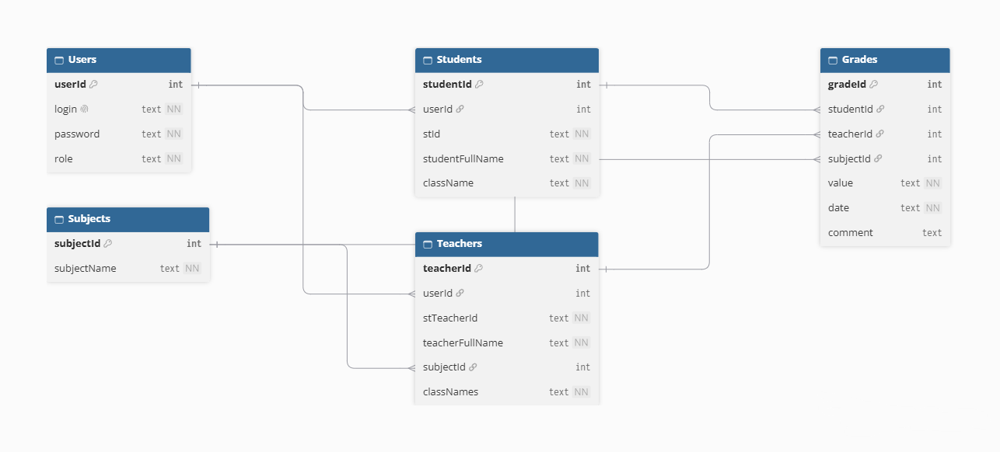

# Электронный журнал

Desktop-приложение для ведения учебного журнала с разделением ролей: администратор, преподаватель и ученик.

Проект создан для автоматизации процесса выставления и хранения оценок в учебном заведении. Вместо бумажного журнала или Excel-таблиц используется единая система, где:

- Администратор управляет пользователями и предметами
- Преподаватель выставляет оценки и ведёт журнал по классам
- Ученик просматривает свои оценки и средний балл

Все данные хранятся в локальной базе данных SQLite, интерфейс построен на JavaFX в тёмной теме.

## Функционал

### Администратор
- Создание аккаунтов преподавателей и учеников с автоматической генерацией логина и пароля
- Просмотр списка всех пользователей в таблице
- Редактирование данных: смена класса у ученика, предмета и классов у преподавателя
- Удаление пользователей
- Добавление предметов

### Преподаватель
- Журнал в виде таблицы: строки — ученики, столбцы — дни месяца
- Навигация по месяцам стрелками
- Выбор класса через выпадающий список
- Выставление оценок через всплывающее окно рядом с ячейкой (5, 4, 3, 2, 1, A, B, C, D, E, F, Н, Б, УП)
- Комментарии к оценкам (например, «Контрольная работа»)
- Умная блокировка кнопок: если у ученика уже есть цифровые оценки — буквенные недоступны, и наоборот
- Автоматический расчёт среднего балла (числового или буквенного)
- Расчёт среднего балла за произвольный период (выбор дат вручную)
- Экспорт журнала за месяц в Excel (.xlsx)

### Ученик
- Просмотр журнала по предметам и дням месяца
- Навигация по месяцам
- Расчёт среднего балла за выбранный период по каждому предмету

## Технологии
- **Java 17** — основной язык
- **JavaFX 17.0.6** — графический интерфейс
- **SQLite 3.42** — база данных (файл `journal.db` создаётся автоматически при первом запуске)
- **Apache POI 5.2.3** — экспорт в Excel
- **Maven** — сборка проекта

## Архитектура
Проект построен по паттерну MVC с разделением на слои:

- **Модели** (`Student`, `Teacher`, `User`, `Subject`, `Grade`, `GradeCell`) — описывают сущности
- **SQLmanager** — единственный класс для работы с базой данных, содержит все SQL-запросы
- **Панели** (`AdminPanel`, `TeacherPanel`, `StudentPanel`) — отвечают за интерфейс каждой роли
- **LoginApp** — точка входа, управляет авторизацией и переключением между панелями

База данных состоит из 5 таблиц со связями через внешние ключи с каскадным удалением.

## Схема базы данных



Таблицы:
- **Users** — логины, пароли, роли
- **Students** — ученики, привязаны к Users, содержат класс
- **Teachers** — преподаватели, привязаны к Users, содержат предмет и список классов
- **Subjects** — справочник предметов
- **Grades** — оценки, связаны со студентом, преподавателем и предметом

## Как пользоваться

### Первый запуск
1. Собрать и запустить проект (см. раздел «Установка»)
2. При первом запуске появится окно создания администратора — ввести логин и пароль
3. Войти под созданным аккаунтом

### Настройка системы (под администратором)
1. Нажать «Добавить предмет» — ввести название (например, «Математика»)
2. Нажать «Добавить учителя» — ввести ФИО, классы через запятую (например, `9А, 10Б`), выбрать предмет. Система выдаст сгенерированный логин и пароль — их нужно сохранить
3. Нажать «Добавить ученика» — ввести ФИО и класс (например, `9А`). Система также выдаст логин и пароль

### Работа преподавателя
1. Войти под логином и паролем учителя
2. Выбрать класс из выпадающего списка
3. Листать месяцы стрелками
4. Кликнуть на ячейку на пересечении ученика и даты — появится окошко с кнопками оценок и полем для комментария
5. Нажать «Экспорт в Excel» для сохранения журнала

### Работа ученика
1. Войти под логином и паролем ученика
2. Листать месяцы, смотреть оценки по предметам
3. Кликнуть на ячейку «Средний балл» — можно рассчитать балл за любой период

## Установка и запуск

### Требования
- Java 17 или выше
- Maven 3.6+

### Запуск
```bash
git clone https://github.com/ТВОЙ_НИК/Journal.git
cd Journal
mvn javafx:run
```

## Планы на развитие

В следующих версиях проекта планируется:

- **Улучшение графического интерфейса** — адаптивная вёрстка под разные разрешения экрана, иконки вместо текстовых кнопок, более приятный внешний вид
- **Электронный дневник** — отдельный раздел с расписанием уроков на неделю, списком кабинетов и учителей
- **Домашние задания** — преподаватель сможет задавать ДЗ с дедлайном, ученик — отмечать выполнение
- **Графики успеваемости** — визуализация динамики среднего балла по предметам и за период (линейные графики, диаграммы)
- **Уведомления** — оповещения учеников и родителей о новых оценках и домашних заданиях
- **Мобильная версия** — адаптация интерфейса под смартфоны и планшеты
